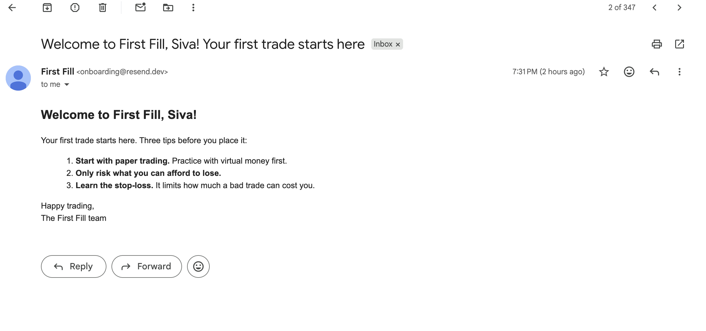

# Friction diary: Swytchcode onboarding

Environment: macOS, zsh, Node v26.0.0, Swytchcode CLI 2.25.5, integration `Resend.resend@1.5.0`.
Date: 5 November 2026.

Each entry: **Step** · **Command / action** · **Expected** · **Actual** · **What I tried next** · **Resolved?**

---

## 1. swytchcode.com would not load

- **Step:** Assignment step 1, finding the install instructions
- **Action:** Opened https://swytchcode.com in Chrome
- **Expected:** Swytchcode homepage with a link to the CLI docs
- **Actual:** Chrome showed a server-side error when I first tried (around 6:30 pm IST). I didn't capture the exact error code at the time.
- **Tried next:** Used the CLI README on GitLab (gitlab.com/swytchcode/cli) and the co-founder's dev.to post for install instructions. Rechecked at ~10 pm IST and the site loaded fine.
- **Resolved?** Yes, it was intermittent. A first-time visitor hitting this error at the very first step could easily give up.

## 2. Unclear which CLI install I was using

- **Step:** Installing the CLI
- **Command:** `which swytchcode` → `/opt/homebrew/bin/swytchcode`; `ls -l` showed it linked to `../lib/node_modules/swytchcode/...`
- **Expected:** The docs' install method (curl script) to match what was on my machine
- **Actual:** An old npm-installed version (2.20.15, from August) was already on my PATH. `init` printed "update available: 2.20.15 -> v2.25.5, npm update -g swytchcode". It took extra steps to work out that this was an npm install, because the docs lead with curl.
- **Tried next:** Checked the symlink, then ran `npm install -g swytchcode@latest`
- **Resolved?** Yes, now on 2.25.5

## 3. Editor options don't match the docs; VS Code not listed

- **Step:** `swytchcode init`
- **Command:** `swytchcode init` → "Which editor do you use?"
- **Expected:** The options in the GitLab README: `cursor | claude | none`
- **Actual:** The CLI shows 9 options (cursor, claude, codex, copilot, gemini, hermes, openclaw, windsurf, none). VS Code is not an option, so as a VS Code + Claude Code user I had to guess.
- **Tried next:** Chose `none` and ran Swytchcode commands manually
- **Resolved?** Yes, but the docs are behind the CLI

## 4. Wrong canonical ID in the blog post

- **Step:** Choosing the email method
- **Command:** `swytchcode list methods resend`
- **Expected:** `emails.email.create`, as in the dev.to walkthrough
- **Actual:** The real ID is `resend.email.create`
- **Tried next:** Used the ID from `list`
- **Resolved?** Yes

## 5. Confusing method names with "1" suffixes

- **Step:** Exploring Resend methods
- **Command:** `swytchcode list methods resend`
- **Expected:** One clear name per operation
- **Actual:** Pairs like `send.create` / `send.create1`, `segment.create` / `segment.create1`, `topic.get` / `topic.get1`. Only reading the Wrekenfile showed they are different endpoints (e.g. `send.create` sends a broadcast, `send.create1` sends an event). The list output gives no summary to tell them apart.
- **Tried next:** Searched the Wrekenfile for each ID and read its `SUMMARY` and `ENDPOINT`
- **Resolved?** Understood, but only by reading the raw spec

## 6. Some methods missing from `list`

- **Step:** Comparing `list` output with the Wrekenfile
- **Command:** `swytchcode list methods resend`
- **Expected:** Every method in the Wrekenfile to be listed
- **Actual:** `resend.api_key.create/list/delete` and `resend.contact_property.*` are defined in the Wrekenfile but don't appear in `list`. Their keys use `_` (`api_key`) but their `CANONICAL_ID` uses `-` (`resend.api-key.create`), which may be why.
- **Tried next:** Compared the method keys and `CANONICAL_ID` values in the Wrekenfile
- **Resolved?** No. Looks like a bug in the spec or the CLI.

## 7. Generated files don't match the README

- **Step:** Inspecting files after `swytchcode get resend`
- **Command:** `find .swytchcode -name "*.yaml" -o -name "*.json"`
- **Expected:** `wrekenfile.yaml`, `methods.json` and `workflows.json`, as the README describes
- **Actual:** Only `wrekenfile.yaml` at first; `methods.json` appeared later (after `add`). No `workflows.json`. There was also a `workspace.json` the README doesn't mention.
- **Tried next:** Checked again after `add`
- **Resolved?** Partly. The README is out of date for 2.x.

## 8. How to provide the API key isn't explained

- **Step:** Preparing to execute
- **Command:** `swytchcode info resend.email.create`
- **Expected:** Instructions for passing my Resend API key
- **Actual:** It shows `"Authorization": "bearer_token"` and `Auth: type api_key`, with no explanation. I first passed `--header Authorization="Bearer ..."`; the "Missing credentials for resend. Connect now?" prompt only appeared at `exec` time.
- **Tried next:** Answered `Y` and entered the key. Swytchcode said it was "stored locally, encrypted".
- **Resolved?** Yes. The connect flow is good, but it should be mentioned before `exec`.

## 9. "failed to read body file" doesn't say why

- **Step:** First dry run
- **Command:** `swytchcode exec resend.email.create --body body.json --dry-run`
- **Expected:** A preview of the request
- **Actual:** `{"error":"failed to read body file","reference_id":"SWY-ERR-54A647"}`. The cause was my file being saved inside `.swytchcode/`, but the error doesn't show the path it looked for or the reason (not found / permission).
- **Tried next:** `ls -la`, found the file in the wrong folder, moved it
- **Resolved?** Yes. My mistake, but a clearer error would have saved time.

## 10. Sandbox mode has no base URL for Resend

- **Step:** Dry run
- **Command:** `swytchcode exec resend.email.create --body body.json --dry-run`
- **Expected:** Request to `https://api.resend.com/emails`
- **Actual:** Warning that the base URL for sandbox "is not set", and the request went to `https://base-url-not-set.invalid/emails`. Resend has no sandbox server, yet the Wrekenfile's `DEFAULTS` contains `w_base_url: https://api.resend.com`, which Swytchcode ignored.
- **Tried next:** Followed the warning's suggestion: `export SWYTCHCODE_BASE_URL_RESEND_RESEND_SANDBOX=https://api.resend.com`
- **Resolved?** Yes with a workaround. Note: "sandbox" mode now sends real emails. The default mode recommended at `init` doesn't work out of the box for Resend.

## 11. `swytchcode-runtime` npm package is unpublished

- **Step:** Building the Node example (assignment step 4)
- **Command:** `npm install swytchcode-runtime dotenv`
- **Expected:** The runtime installs, as recommended by Swytchcode's npm page and the dev.to post
- **Actual:** `npm error code ENOVERSIONS / No versions available for swytchcode-runtime`. `npm view swytchcode-runtime` → `404 Unpublished on 2026-07-16T14:34:19.875Z`
- **Tried next:** Searched the web (found it listed on pkgstats, v0.1.5); used the `spawnSync` pattern from the CLI README to call `swytchcode exec` directly
- **Resolved?** Worked around it. The recommended path for JavaScript developers is broken.

---

## Spec observations (Wrekenfile)

- `resend.email.create`: `body` is marked `REQUIRED: false`, but `from`, `to` and `subject` inside it are required. An empty call would pass Swytchcode's validation and only fail at Resend.
- `to` is shown as a `ONE_OF` object with `variant_0` (string) / `variant_1` (list of strings). It's unclear whether to pass a plain string (a plain string worked).
- `resend.email.update` is a `PATCH` but has no `body` input, and its return type is `UpdateEmailOptions` (a request type) instead of a response type.

## What worked well

- `--dry-run` shows the exact method, URL, headers and body before anything is sent. This was the most useful debugging tool.
- The API key is stored locally and encrypted, and dry-run output shows `Authorization: [REDACTED]`, so the key never appears in logs or in this repo.
- Once set up, sending an email was one command, and calling it from Node took about 15 lines.
- Clear success: email ID `01a1ac03-361a-7d98-8507-70952accd8cb` delivered to my inbox.

## Demo Video

https://youtu.be/kNKElIs-QU4?si=TsN_4-rs_fmfi67j
